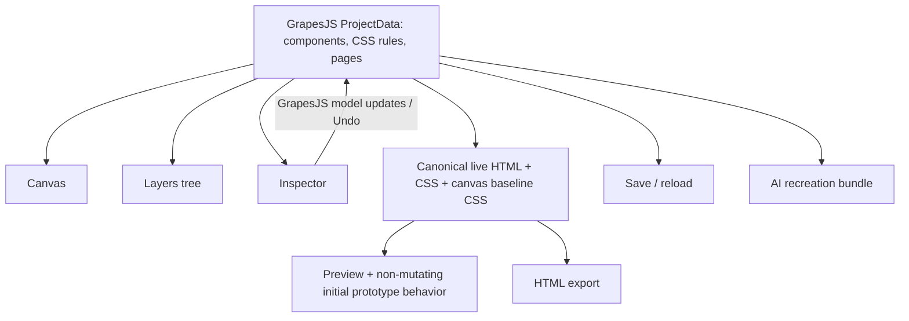

# Forma editor fidelity diagnosis

## Findings

GrapesJS `ProjectData` is the persisted document: page component trees, attributes, component names, and CSS rules. The canvas, Layers tree, and most edits already use that model. Save and autosave serialize `editor.getProjectData()`. Preview and HTML export already requested the selected page's live `editor.getHtml()` and `editor.getCss()`, but the render paths were not equivalent.

The first confirmed preview defect was caused by `prototypeRuntime()` running only in Preview. Its startup `update()` rebuilt file lists and summary content, while the GrapesJS canvas displayed the saved component tree as-is. Preview also refit the entire document after every click, so switching to content with a different height could change the outer scale. Finally, GrapesJS `protectedCss` was applied to the editor canvas but omitted from Preview and HTML export, allowing browser defaults and body styling to diverge.

The Inspector's fill resolver read `background-color` only. CSS gradients live in `background-image`, so they could be shown as a fallback color or black. Effect state was reduced to an on/off shadow button and ignored computed shadows, backdrop filters, and filters. These are view-resolution gaps; they do not require a second document model.

## Architecture

Before:

```text
GrapesJS ProjectData -> GrapesJS canvas
                   -> Layers tree
                   -> Inspector (small inline/computed property subset)
                   -> Preview (live HTML/CSS + mutating prototype runtime - canvas protected CSS)
                   -> Save (ProjectData)
                   -> HTML/AI export (live HTML/CSS - canvas protected CSS)
```

After:



## Changes

- `dist/style-resolver.js` resolves solid, image, linear, radial, and conic CSS fills, parses nested color functions and multiple shadows, and edits an individual gradient stop while preserving its siblings and additional background layers.
- `dist/fidelity.js` adds the resolved fill/effect details to the Inspector, routes color edits into the first gradient stop when a gradient is selected, routes other edits through the selected GrapesJS component, supplies the same protected baseline CSS to exported CSS, and generates Preview from the current live page. Prototype page/theme interactions are attached without rewriting the initial document; fit is recalculated on resize rather than on each click.
- `dist/app.js` loads the focused fidelity modules. Existing GrapesJS ProjectData storage and page model remain intact.
- `tests/style-resolver.test.cjs` covers gradient parsing and stop replacement, nested color functions, multiple backgrounds, shadows, backdrop blur, and opacity.
- `package.json` includes the parser tests in the standard check script.

## Risks and migration

No project schema migration is required. Existing CSS remains valid and saved in its current GrapesJS format. The Inspector currently exposes CSS source for complex or layered fills, along with structured controls for supported gradient stops; CSS constructs outside the resolver's parser remain editable through that source field. Prototype interactions are a preview behavior layered over the document, so state changes made inside Preview are not persisted back to the design model.

The visual style resolver reads computed styles for stylesheet-driven values and uses the selected GrapesJS component for edits. A computed value inherited from a selector is displayed accurately; edits apply as component-level declarations so they remain local to that component.

The original live QA pass found that GrapesJS Undo did not restore an Inspector edit to an imported gradient-backed component. The reliability follow-up replaces the two separate histories with one complete-document history, including CSS rules and Forma metadata. Imported-gradient edit/Undo/Redo/reload and mixed geometry/variable-mode edits now pass the live checks recorded in the test report. Opening another project resets this history; restoring a named version is recorded as one undoable document change.
