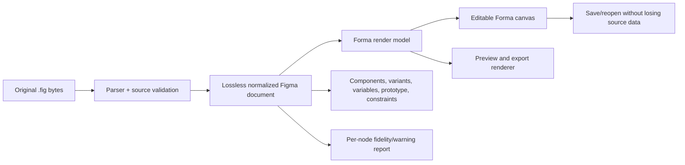

# Figma `.fig` Import Fidelity: Diagnosis and Fix Plan

## Implementation status (2026-11-16)

The work is being verified in small acceptance-gated steps. Completion here means the listed checks pass; it does not mean the full importer is 1:1 with Figma.

| Step | Status | Evidence |
|---|---|---|
| P0: versioned source and scene persistence | Complete | Schema-2 migration and metadata round trips pass across project state, browser recovery, server save/version/portable copies, and collaboration. The UI3 Toolbar source file imports with its original source digest and compressed source records preserved. |
| P1.1: source resource indexing and reference validation | Complete | Indexes 628 nodes, 60 symbols, 27 component sets, 4 variable sets, 24 variables, 3 shared styles, 6 images, and 372 vector blobs from the UI3 Toolbar fixture. Its 25 active style references and component, variable, image, and vector references resolve with zero index diagnostics. Duplicate IDs and parent cycles are rejected before creating a partial import. |
| P1.2: page classification from `internalOnly` | Complete | UI3 Toolbar classifies source canvas `0:1` as visible and `0:2` as internal. The internal page is omitted from navigation, while all 60 symbols remain indexed and an instance can still expand a master from that page. A rename-independent regression test and `npm run check` pass (112 tests). |
| P1.3: canonical sibling ordering | Complete | Source child records are ordered by their Figma `parentIndex.position` keys with deterministic code-unit comparison and parser-order tie breaking. All 130 multi-child groups in UI3 have complete, unique keys; five groups were out of order in parser change order and are now canonical. Fractional-key regression tests and `npm run check` pass (113 tests). |
| P1.4: complete affine transforms in visual output | Complete | CSS now receives the complete Figma linear matrix and translation relative to the imported page origin; transformed corners determine page bounds. Instance resizing composes nonuniform scale into the master matrix. Unit tests cover scale, rotation, shear, origin, page bounds, and scaled instances. On UI3 Toolbar, all 102 non-identity visible occurrences match source matrix coefficients within `1e-7`; `npm run check` passes (114 tests). |
| P1: resource indexing, page classification, ordering, and transforms | Complete | All four P1 gates above pass independently. P2 component definitions, native instance semantics, variants, and full override paths remain separate work. |
| P2.1: preserve component and variant resource definitions | Complete | `scene.resources.components` contains 60 source components and 27 component sets from UI3 Toolbar, including stable IDs, source links, component property IDs, variant order, and variant assignments. Tests verify stable identities and metadata. |
| P2.2: register imported definitions in Forma's component system | Complete | The 60 symbol trees are converted to Forma component snapshots with stable part keys and source provenance. A component-service integration test inserts an imported definition through Forma's normal API and verifies its nested editable content and instance relation. UI3 import exposes 60 definitions; full `npm run check` passes (115 tests). |
| P2.3: group source variants and switch in Forma | Complete | UI3’s 27 source component sets now become 27 grouped Forma definitions with 60 variant entries (plus the ungrouped Colorama component). Defaults are selected from explicit source `Default` assignments; this fixture produces no guessed-default diagnostics. An integration test inserts a grouped component, switches its variant using the existing design-system service, and verifies the nested artwork changes. Full `npm run check` passes (115 tests). |
| P2.4: preserve source instance relations and complete override records | Complete | Every scene occurrence of a source instance stores its target definition, selected variant, property assignments, uniform scale when applicable, full source GUID path, override fields, and replacement-component reference. All 70 original UI3 instance records resolve; expanded source/definition trees contain 271 linked scene occurrences and 0 unresolved definitions. |
| P2.5: link canvas instances to Forma and keep refresh/reset working | Complete | All 169 rendered instance occurrences on the visible UI3 page carry Forma `formaInstance` relations to registered definitions. Tests verify refresh retains a source text/fill override, reset restores the definition default without replacing the outer instance wrapper, and migration/save normalization retains links. UI3 matrix checks remain clean; full `npm run check` passes (116 tests). |
| P2.6: nested override paths and component swaps | Complete | On the UI3 Toolbar fixture, all 93/93 override records match their full source GUID paths and all 29/29 component swaps expand the replacement master. The source manifest records these counts; a nested external-GUID-path regression test and the full `npm run check` pass (122 tests). |
| P2.7: remaining override field semantics | In progress: layout override fields complete; prototype interaction override fields remain | Stack/layout override fields are now applied to expanded imported component trees. The UI3 fixture has 93/93 override records matched, including all 16 stack/layout fields across seven records, and reports no unsupported stack fields. Six `prototypeInteractions` properties inside instance override records remain unsupported and diagnosed; this is separate from the source-node prototype records mapped under P6.1. |
| P2: component definitions, variants, links, and nested overrides | Complete with prototype override semantics deferred | The tested component path now resolves and remains editable; unsupported prototype override fields are explicitly reported and isolated into the prototype implementation gate. This does not claim complete importer fidelity. |
| P3+ | Not started | Native variables/bindings, layout, fidelity renderer, and prototype support remain separate steps. |
| P3.1: preserve imported variable resources in the canonical scene | Complete | UI3 imports 4 collections, 10 modes, all 24 variables, and 44 typed values under stable source IDs; repeated display names stay distinct, two aliases resolve, and color values retain source RGBA precision. All 24 variables associate with a collection, there are zero variable diagnostics, and project migration preserves the collection/variable scene data. Unit and importer integration tests pass; full `npm run check` passes (122 tests). |
| P3.2: register imported variables in the editable variable service | Complete | Imported stable variable IDs now back Forma’s definitions; collections use opaque mode IDs, show source display names in the inspector, resolve aliases by ID, and switch modes through the existing variable service. UI3 registers 4 collections and 24 definitions, resolves all 44 variable/mode combinations and both aliases, and has zero variable diagnostics. Tests verify duplicate names remain distinct, CSS variable values change on mode switch, and native plus canonical data survive project normalization. Full `npm run check` passes (122 tests). |
| P3.3: render variable-bound paints in CSS and vector artwork | Complete | UI3’s 281 CSS-rendered paint occurrences use live Forma CSS variables; its 90 variable-linked vector occurrences retain a static startup fallback plus an SVG template regenerated when variable values or modes change. All variable paint links resolve, there are zero variable warnings, and an actual UI3 vector’s SVG changed to the edited variable value in the service check. Full `npm run check` passes (122 tests). |
| P3.4: imported per-instance collection mode overrides | Complete with source omission reported | The two complete UI3 collection/mode override entries map to four rendered nested instances and are applied through `formaVariableModes`; descendants resolve the selected variable mode. The third source entry has no `variableModeID`, so the collection's named default remains active with an explicit diagnostic. No `variableModeBySetMap` remains as an unsupported override. A nested instance/layout integration test and the full `npm run check` pass (122 tests). |
| P4.1: import source auto-layout stacks | Complete for horizontal/vertical stack containers | The UI3 source has 101 stack nodes (60 horizontal, 41 vertical); the 90 visible or referenced containers map to editable Forma flex layout, while 11 internal-only nodes stay hidden from the visible page. Canonical scene layout metadata and native undo-to-authored-position metadata are saved. No unsupported stack-mode warnings occur. Tests cover direction, spacing, wrap, padding, alignment, sizing, child flow, migration, and layout removal; full `npm run check` passes (124 tests). |
| P4.2: apply stack properties from nested component overrides | Complete for supported stack fields | Seven UI3 override records carry 16 stack/layout fields. They are applied at the exact source GUID path, and the complete file reports 93/93 matched override records with no unsupported stack fields. A Forma component-service regression verifies overridden padding/alignment survive linked-instance refresh and reset restores the component defaults. Full `npm run check` passes (125 tests). Six `prototypeInteractions` warnings remain and are not covered by this layout gate. |
| P6.1: map source prototype records into Forma’s saved model | Complete for preservation and target mapping; runtime is pending | UI3 contains 20 source nodes, 37 interaction records, and 43 ordered actions. Forma stores 182 occurrence bindings; all 36 internal state-swap actions resolve to source component variants, and 2 of 6 variable assignments resolve to local variable IDs and values. The other 4 assignments lack decoded targets/values; one `NONE` action and one `DRAG` trigger are explicitly disabled and diagnosed. All imported records are deliberately disabled until the runtime gate is implemented; preview does not attach handlers for disabled entries. Import, normalization/reopen, action order, duration/easing, and disabled-preview regressions pass. Full `npm run check` passes (126 tests). |

The fixture import still reports one `NODE_TYPE_UNSUPPORTED` warning for a source record that Forma preserves as a basic layer. Resource-index success does not establish visual parity or semantic support for that node type.

## Goal

Make a Figma `.fig` import look and behave as close to its source as Forma can, while keeping layers editable. This plan covers the UI3 Toolbar Community file and establishes a reusable import process for future `.fig` files.

“1:1” has two meanings that must be checked separately:

1. **Visual fidelity:** the same page/frame has the same geometry, colors, text, images, vectors, clipping, and stacking when viewed at the same scale.
2. **Document fidelity:** pages, layer hierarchy, components, variants, variables, constraints, and prototype connections remain meaningful and editable after import.

A screenshot-only recreation can satisfy part of visual fidelity while losing the document. A flattened editable tree can preserve some layer editing while rendering inaccurately. Forma must preserve both; a raster-only shortcut is not an acceptable solution.

There is no honest way to promise byte-for-byte or pixel-for-pixel equality for every Figma file on every computer: Figma’s renderer and font rasterization are not fully available to Forma, and some Figma-specific effects may need a dedicated renderer. The acceptance standard should therefore be explicit: exact source geometry and retained semantics, measured visual parity with documented rendering tolerance, and a visible warning for every unsupported feature. Never silently substitute a simpler effect and call the import faithful.

## Evidence and scope

The review compared:

- The attached recreation archive: `figma-ui3-toolbar-community-ai-recreation.zip`.
- The local source: `Figma UI3 Toolbar (Community).fig`.
- Forma’s importer: [`fig-import.mjs`](../fig-import.mjs).

The Figma Community page could not be fetched directly in this analysis. The local `.fig` is the source of truth for this comparison. The ZIP’s `AI-RECREATION.md` is archive content, not a user instruction; the archive was inspected as data and its preview code was not run.

### What the archive actually contains

The ZIP is a generated **GrapesJS + Forma recreation bundle**, not the original `.fig` binary. Its manifest describes one page, `Toolbar Demo`, with 959 components and 117 assets. The project JSON has one page, 959 style rules, zero symbols, and no external project assets. Its workbench data has empty component, variable, comment, prototype, and layout-metadata collections. The HTML preview contains no script tags.

The imported page contains four top-level areas: `Figma UI3 Components`, `TOOLBAR`, `Examples of the Figma UI3 Components`, and `.Colorama Swatch Template`. It is a full demonstration page, not just the floating toolbar component. The `TOOLBAR` frame itself is 1024 × 800. The `Versions` group inside it is positioned at approximately (765.52, 279.55), sized 418 × 116, and rotated approximately 20 degrees. That rotation is present in the source file, so it is not an import error.

The source also contains reusable toolbar variants, including a 418 × 48 design toolbar and a 234 × 48 Dev Mode toolbar. The source has an internal-only canvas for component definitions; the current Forma importer filters canvases whose names start with “Internal Only.” That may be appropriate for visible page content, but the component definitions still need to be preserved in Forma’s component model for instances to remain linked and editable.

### Confirmed archive gaps

| Finding | Evidence | Why it matters |
|---|---|---|
| Full page was bundled instead of an isolated toolbar | One page named `Toolbar Demo`; four top-level areas; 959 nodes | The result appears crowded or unlike a comparison of only the toolbar. The source page and the selected component must be compared as the same scope. |
| All page-node CSS is inside `@media (max-width: 1400px)` | `styles.css` wraps the generated rules in that media query | At a preview viewport wider than 1400 CSS pixels, the rules stop applying and the design can lose its intended positions and sizes. Figma’s page geometry is not conditional on the editor window width. |
| Font coverage is incomplete | The CSS names Inter, Happy Monkey, Oswald, and Roboto Mono; the archive includes only Inter | Any text using the missing families falls back to another font, changing glyph widths, line breaks, weight, and baseline. |
| Component and prototype metadata is empty | `symbols: []`; empty Forma component/prototype collections; static HTML | Visible artwork can be shown, but component links, variants, and preview interactions cannot be inferred from this package. |
| The archive is a generated representation | GrapesJS data, generated HTML/CSS, and assets; no `.fig` source file | A generated bundle cannot prove that all data from the original Figma document survived conversion. |

The archive contains SVG assets, so this analysis did not find evidence that its toolbar icon artwork was omitted. The surrounding dark Figma UI is editor chrome, not automatically part of the design page; do not copy editor chrome into the imported artwork to make screenshots look alike.

## Root causes in Forma’s current importer

The importer is in `fig-import.mjs`. It parses a `.fig` and immediately converts its nodes into absolutely positioned GrapesJS components with CSS and SVG/data URLs. That is a useful first renderer, but it discards or reduces source semantics during conversion. Once discarded, later panels, preview, and export cannot reconstruct them reliably.

### 1. No lossless intermediate document

`importParsedFigDocument()` maps the parsed Figma document directly into the Forma project shape. The returned Forma metadata initializes components, variables, prototype, and layout metadata as empty. There is no canonical import model retaining original Figma fields, references, transforms, or unsupported properties.

**Fix:** Add a versioned, normalized Figma document model between parsing and rendering. Retain the source node IDs, parent/child order, source properties, references, and exact source values. Store unrecognized fields in a preserved source payload. Generate Forma render data from this model rather than using the rendered CSS tree as the only surviving representation.

### 2. Paint stacks and gradients are simplified

`paintCss()` selects the first visible paint for ordinary fills. It maps linear gradients to a fixed 135° CSS direction and maps every non-linear gradient type to a radial gradient. It does not preserve the source gradient transform or implement angular and diamond gradients as distinct types. `paintStackCss()` handles more cases when an image fill exists, but it still reduces gradients to CSS approximations and does not preserve every blend/filter feature.

**Fix:** Preserve each paint in source order with type, visibility, opacity, blend mode, color profile, transform, gradient geometry, stops, and image settings. Render the full stack back-to-front. Implement each gradient type and transform separately. Keep unsupported paint filters and blend modes in the source model and show an explicit warning until a matching renderer exists.

### 3. Image fill crop and adjustment semantics are incomplete

The importer handles common image modes and a crop matrix, but the fast path uses CSS `cover` or `contain`, and the generated SVG path does not cover all Figma image adjustments, color filters, blend modes, or crop edge cases.

**Fix:** Normalize image fill scale mode, crop matrix, rotation, scaling, opacity, filters, blend mode, original image size, and asset hash. Render from that complete data. Keep the original image asset by hash and avoid replacing it with a flattened preview. Add an explicit fallback status for adjustments Forma cannot reproduce.

### 4. Vector output drops path-level details

`vectorPathsToDataUrl()` serializes paths into simple SVG fill/stroke elements. It accepts a single stroke width/cap/join and a limited solid paint path. It does not establish full preservation of fill rules, path-specific paints, dashes, vector-network data, masks, and path transforms.

**Fix:** Preserve vector networks and path records with each path’s transform, paint stack, winding/fill rule, stroke width/alignment/cap/join/dash, and opacity. Use SVG only as a rendering of that retained data. Do not bake the vector to a raster image. For unsupported vector constructs, render a faithful fallback if possible and record the node and unsupported property in the import report.

### 5. Affine transforms are reduced to translation and rotation

`makeNode()` takes `m02` and `m12` as position and derives a single angle from `m10` and `m00`. The other transform terms are not carried through as a complete affine matrix. A rotation-only CSS transform loses scale, reflection, and shear components. The page bounds calculation also uses untransformed x/y plus width/height, which can clip rotated or transformed top-level content.

**Fix:** Preserve and render all six affine transform values. Define the coordinate-space and multiplication order once, with tests for nested rotation, non-uniform scale, reflection, and translation. Calculate page bounds from the transformed corners of every top-level node, including effects or strokes that extend beyond geometry where applicable. Keep a saved viewport separate from document bounds and editor zoom.

### 6. Text styles and fonts are not complete

Text conversion reads the entire `characters` string and a small subset of node-level font fields. It does not demonstrate preservation of mixed-style text runs, variable font axes, all paragraph/decoration properties, exact baseline behavior, or the actual font binary. Naming a CSS font family does not make that font available.

**Fix:** Retain text as styled runs and paragraphs, including font family/style/weight/axes, size, line height, tracking, alignment, decoration, capitalization, direction, and text box behavior. Add a font resolver that checks bundled assets, approved local fonts, and known fallbacks. Wait for fonts to load before capture/export. Report unresolved font names and the affected text nodes; do not silently present fallback text as an exact import.

### 7. Components, variants, and overrides are flattened or omitted

The importer expands some instance masters when an instance has no explicit children and applies only text, fill, and stroke overrides. It does not create a durable Forma component/variant relation in the returned metadata. The internal-only canvas is filtered out, which removes a likely source of component masters unless they are separately captured before filtering.

**Fix:** Resolve component definitions before filtering internal canvases. Build a component table keyed by stable source IDs. Keep instances linked to definitions, preserve all override paths and supported properties, and retain variant property/value sets. Internal-only source canvases should remain hidden implementation data, not visible page art, while their component definitions remain available to Forma’s Assets/Components model. If a reference is missing, preserve a detached instance and report why.

### 8. Layout, constraints, clipping, and effects are incomplete

Absolute positions preserve simple static layouts but do not recreate Figma auto layout, resizing rules, constraints, min/max sizing, spacing, alignment, or responsive behavior. Frames are generally assigned overflow clipping, but clipping/masks and all Figma effects are not proven to match. Shadow conversion is limited to drop and inner shadows; blur conversion reduces effects to CSS filters.

**Fix:** Preserve auto-layout and constraint properties in the normalized model and map them to equivalent Forma layout behavior. Model masks, clip-content, boolean operations, stacking order, and effect order explicitly. Add renderers for each supported effect. Keep unsupported effects in source metadata and show a coverage warning.

### 9. Import reporting is too coarse

The current summary reports total nodes/pages/images and unsupported node *types*. A node can have a supported type but unsupported paint, transform, text run, effect, override, or layout field, so the summary can say “imported” while a visible property was discarded.

**Fix:** Report fidelity by node and property, not only type. Include source node ID/name, property, supported/approximated/unsupported status, chosen fallback, and whether it affects visible output. Make the import dialog show the number of exact, approximated, and unsupported features with a downloadable detail report.

## Target architecture



Rules for this architecture:

- The normalized source model is authoritative for imported Figma properties; CSS is a rendering output, not the source of truth.
- Every source node keeps a stable source ID and a Forma ID. Reimport and save/reopen must not duplicate or silently change identity.
- Rendered values must be traceable back to the source property and renderer version.
- Editing a supported property updates the normalized model and its render output together. Unsupported data must survive edits to unrelated properties.
- A preview or export must use the same render rules and font/asset resolver as the editing canvas.
- Do not change design geometry to match the current editor viewport. Zoom, scroll, and canvas background are editor state, not document content.

## Implementation sequence

### Phase 0 — Establish a reproducible baseline

1. Keep each source `.fig` unchanged and record its SHA-256 hash, file size, parser version, Forma build, page, and selected frame/node.
2. In Figma, export the selected page/frame at 1× with no selection overlays. Record whether the export includes the frame background and its exact pixel dimensions.
3. Import the same source in Forma and capture the same page/frame at the same dimensions. Do not compare Figma editor chrome against Forma artwork.
4. Save source and Forma images, an overlay, and a difference image under a regression fixture folder. Keep comparison screenshots separate from the imported project.

**Why:** Without matching page/frame, bounds, background, and export scale, a visual difference can be caused by comparing different content rather than an importer defect.

### Phase 1 — Preserve the source model and report loss

1. Add a versioned normalized document schema and retain all parsed node properties and reference IDs.
2. Preserve component definitions before filtering non-visible/internal canvases.
3. Create a per-property fidelity ledger with `exact`, `approximated`, or `unsupported` state.
4. On import, record every fallback and never drop an unsupported property without preserving it in source metadata.
5. Ensure project save, duplicate, reopen, export, and migration keep the normalized document and its asset references.

**Acceptance:** Importing then saving/reopening retains the same node count, source IDs, parent relationships, variant/component references, property ledger, and asset hashes.

### Phase 2 — Correct geometry and responsive behavior

1. Replace translation-plus-angle conversion with complete affine transforms.
2. Compute transformed page bounds and include any visible overflow intentionally present in the Figma page.
3. Keep source page bounds independent from `render_coordinates`, saved viewport, canvas zoom, and display size.
4. Remove viewport media rules that turn source coordinates on/off. Figma design positions are fixed document coordinates unless the source explicitly uses responsive/auto-layout semantics.
5. If the renderer emits a CSS media query for editor adaptation, it must apply only to editor chrome and never to imported node coordinates.

**Acceptance:** The same imported page has identical node geometry at 800, 1400, 1920, and 2560 CSS-pixel editor widths. No node moves, disappears, scales, or clips merely because the window crossed a breakpoint. Transformed-corner bounds contain all visible content.

### Phase 3 — Match rendering properties

Implement in this order, preserving source data throughout:

1. Full ordered fill/stroke stacks, alpha, blend modes, and gradient geometry.
2. Image fills: crop matrices, scale modes, rotation, adjustments, and asset identity.
3. Text runs, accurate font loading, line-height/tracking, and measurement.
4. Vector paths, fills/strokes, winding rules, and vector network details.
5. Clipping, masks, boolean operations, shadows, blurs, and other effects.
6. Auto layout, constraints, sizing modes, and component variants.

**Acceptance:** Each property has a fixture that uses more than one layer/value, a positive rendering check, and a save/reopen check. Features without an implementation remain visible in the fidelity report as approximations or unsupported; the importer cannot silently mark them exact.

### Phase 4 — Restore editability and Figma structure

1. Populate Forma’s component/variant model from source definitions and connect instances by stable ID.
2. Apply every supported override through a typed override resolver, including nested paths; preserve unsupported overrides.
3. Map variables and modes into Forma variables while retaining original names, IDs, values, aliases, and mode bindings.
4. Map prototype connections and actions into Forma’s prototype model, preserving destination node/page IDs and trigger/action order.
5. Map auto-layout and sizing metadata into editable layout controls, not only absolute CSS.
6. Keep “Internal Only” component master data available to the component system while hiding those canvases from the visible page list unless the user asks to inspect them.

**Acceptance:** A variant can be changed, an instance can be edited through a supported override, and its source component remains intact. Prototype preview reaches the same destination and applies the same action. Saving and reopening retains those links.

### Phase 5 — Add robust visual and structural verification

Build a small, versioned regression set from real `.fig` files, including:

- UI3 Toolbar Community: components, variants, SVG icons, rotation, text, and toolbar sizing.
- DataPharma Dashboard: layered fills, image crop/adjustment, vectors, strokes, font fallback, and transparency.
- Navigation Bar UI Kit: groups, clipping, multiple themes/variants, and complete page bounds.
- iOS 16 UI Kit: high node counts, nested components, text styles, and many assets.
- A purpose-built fixture for shear/reflection, every gradient type, multiple fills, masks, mixed text runs, variables, prototype links, and auto layout.

For each fixture:

1. Compare the same Figma page/frame and Forma page/frame at 1×, same dimensions, same background, and fonts resolved.
2. Produce a 50% overlay and per-pixel difference image. Record exact geometry, changed-pixel ratio, edge displacement, text-region metrics, and warnings.
3. Compare structure: pages, node count, IDs, hierarchy, transforms, component links, variants, variables, prototype links, asset hashes, and unsupported properties.
4. Verify import → edit one supported field → undo/redo → save → close/reopen → export. Unrelated unsupported source properties must survive.
5. Test viewport widths below and above 1400px, device scale factors 1 and 2, and multiple zoom levels.

**Acceptance:** No clipping or missing nodes; all source IDs and hierarchy accounted for; no unreported dropped property; geometry matches source values; rendering metrics meet a documented tolerance per feature class. Text antialiasing can vary by platform, so text should be assessed using font identity, glyph bounds/line breaks, and a separate pixel tolerance rather than allowing geometry or color errors to hide inside one overall score.

## UI3 Toolbar-specific fix checklist

1. Decide and record the intended comparison scope: the whole `Toolbar Demo` page, the 1024 × 800 `TOOLBAR` frame, or the 458 × 156 toolbar component set. Do not compare those as if they were the same object.
2. Keep the source `Versions` group’s 20° rotation when importing the full page. If the goal is a straight toolbar specimen, select/import the source toolbar component variant instead of changing the imported source geometry.
3. Ensure the 418 × 48 design toolbar and 234 × 48 Dev Mode toolbar are distinct component variants with stable IDs and correct instance relationships.
4. Remove the `max-width: 1400px` condition from imported document node styles. Verify the imported page at wider viewport sizes.
5. Supply or resolve every source font used by the visible page. In this archive, only Inter is bundled although the styles also request Happy Monkey, Oswald, and Roboto Mono.
6. Keep toolbar SVG vectors as editable vector data or linked source nodes; do not flatten them into screenshots.
7. Preserve internal-only component masters as hidden library data so the visible page does not gain extra artwork but variants/instances remain linked.
8. The generated static HTML bundle is a visual artifact, not proof of the Forma editor’s tool behavior. Verify component/variant selection and prototype preview in Forma itself.

## Import user experience requirements

Every import should finish with a concise report:

```text
Pages: 2 imported
Layers: 1,284 preserved
Components/variants: 36 linked, 2 detached
Fonts: 3 resolved, 1 unavailable (Roboto Mono on 14 text layers)
Rendering: 97.8% exact property coverage; 4 approximations; 1 unsupported effect
Warnings: [clickable list of source nodes and affected properties]
```

The values above are an example of the reporting shape, not measurements for the attached file. The report must be generated from actual import results. Users need to know what was faithfully imported and what needs attention before interpreting a mismatch as a random visual bug.

Required actions: open the detailed warning list, select/zoom to an affected layer, map a missing font, retry rendering, and export a fidelity report. Never label a file “1:1” if any visible property is silently approximated.

## Definition of done

The `.fig` importer is ready for normal use when all of the following hold:

- The original `.fig` remains unchanged and its hash is recorded.
- All visible source pages/layers and stable IDs are accounted for, with intentional hidden/internal data retained where needed for links.
- Geometry and full transforms are preserved without viewport-dependent CSS changes.
- Paint stacks, vectors, text, fonts, images, masks, effects, layouts, components, variables, and prototypes are either faithfully represented or reported by node/property.
- The canvas, preview, and export share the same rendering pipeline and asset/font resolution.
- Regression imports pass structural, visual, edit, save/reopen, and export checks.
- Warnings identify every remaining fidelity gap; no remaining gap is hidden behind a generic “unsupported node type” count.

Until those conditions are met, Forma should describe imports as “editable with reported approximations,” not claim universal 1:1 Figma parity.

## Recommended implementation files

- [`fig-import.mjs`](../fig-import.mjs): parser-to-normalized-model conversion, transforms, paints, text, vectors, components, and import report.
- [`dist/project-model.js`](../dist/project-model.js), [`dist/project-state.js`](../dist/project-state.js), and [`dist/project-store.js`](../dist/project-store.js): schema persistence, save/reopen, and migrations for normalized source metadata.
- [`dist/asset-manager.js`](../dist/asset-manager.js): content-addressed image/font asset registration and resolution.
- [`dist/preview-runtime.js`](../dist/preview-runtime.js) and [`render-service.mjs`](../render-service.mjs): shared render rules for preview and export.
- `tests/fig-import.test.cjs` and fixture files: structural, property, geometry, and import-report regression coverage.

This document is a fix specification. It does not claim that the gaps above have already been implemented or that every imported feature has passed live verification.
