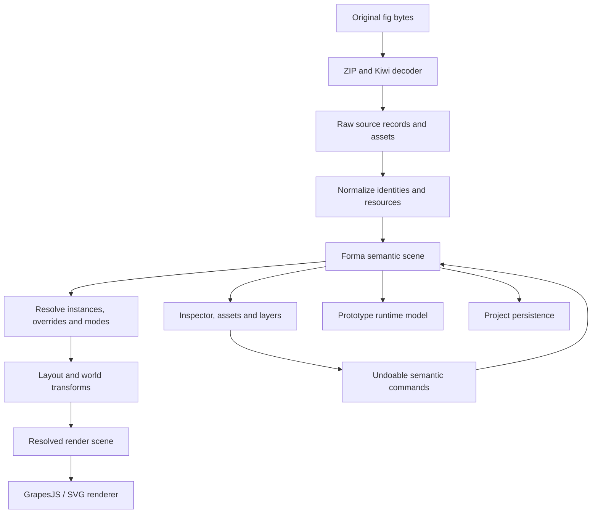

# Forma `.fig` Semantic Import and Editing Fidelity — Technical Specification

**Date:** 2026-11-16, America/Sao_Paulo  
**Status:** Proposed engineering specification; application changes are not implemented by this document.  
**Primary implementation:** `figma-studio/fig-import.mjs` and the existing services in `figma-studio/dist/`.  
**Reference fixture:** `C:/Users/Adriano/Downloads/Figma UI3 Toolbar (Community).fig`  
**Fixture SHA-256:** `12b55fd2c3429452749c809f6b22ae3d18827050dbb8f04c4ddef3eff5273ee3`

## 1. Objective and evidence boundaries

Implement an import path that reconstructs a document users can continue editing: linked components, variables, Auto Layout, editable vector networks, typography, paint stacks and prototype behavior. The saved appearance is one required result; preserving the relationships that generate that appearance is another.

This specification uses three evidence classes:

- **Observed in the fixture:** decoded node properties, assets, references, geometry and configured actions.
- **Observed in Forma source or import execution:** current conversion behavior and existing service contracts.
- **Proposed:** architecture, interfaces, algorithms, tests and acceptance requirements below.

All TypeScript interfaces and new-module examples are **proposed contracts or reference pseudocode**. They are not existing Forma APIs and are not drop-in implementations. Existing Forma code is JavaScript. TypeScript notation makes contracts explicit without requiring a project-wide language migration.

No Figma runtime was exercised during this investigation. Decoding geometry and resolving references do not establish pixel equivalence, exact event dispatch, shader behavior or Figma's internal cache algorithms. The schema describes more features than this fixture uses. A supported enum value is not evidence of a feature being present in the fixture.

### 1.1 Verified fixture inventory

| Fact | Observed value |
|---|---:|
| Outer file size | 671,513 bytes |
| Binary prelude / version | `fig-kiwi` / `101` |
| Raw node records | 628 |
| Document / pages | 1 / 2 |
| Frames / sections | 126 / 1 |
| Component definitions (`SYMBOL`) | 60 |
| Component instances | 70 |
| Variant groups (`isStateGroup`) | 27 |
| Vectors / boolean operations | 161 / 39 |
| Text records | 14 |
| Variable collections / variables | 4 / 24 |
| Explicit horizontal / vertical stacks | 60 / 41 |
| Binary blobs / packaged images | 372 / 6 |
| Nodes containing prototype interactions | 20 |
| Interaction records / actions | 37 / 43 |

All instance sources and explicit transition destinations resolve. All 161 vectors produce nonempty drawing paths with the installed `openfig-core@0.4.1`. A bounded numeric `*Blob` reference scan found 1,528 references within the 372-entry blob array. Four variable assignment actions lack targets/values; they must remain diagnosed as incomplete.

The six packaged images correspond to three full images plus their three thumbnails. All 39 boolean records in this fixture use `UNION`. Stored paint entries include solid, linear-gradient and image paints. The fixture is insufficient to validate general mask, subtract/intersect/exclude, grid or every gradient implementation.

### 1.2 Measured current Forma import

Running `importFigProject()` on this fixture returned:

```json
{
  "nodes": 958,
  "pages": 1,
  "images": 6,
  "unsupportedTypes": ["SECTION"],
  "figVersion": 101
}
```

The converter also returned empty native `components`, `prototype` and `layoutMetadata` collections and empty light/dark variable maps. The 958 count includes materialized instance contents; it is not comparable to 628 raw records as a preservation percentage. The GrapesJS wrapper brings the total generated component count to 959.

**Why change this:** a toolbar may look approximately correct at its saved size while its icons are unlinked, its theme cannot change and its layout cannot respond. Counting converted DOM objects conceals these semantic losses.

## 2. Current code: integration points and specific failure modes

Paths below are relative to `figma-studio/`.

| Existing file | Current responsibility | Required integration |
|---|---|---|
| `fig-import.mjs` | Parse `.fig`, convert nodes to GrapesJS objects/CSS | Split normalization, resolution and rendering; preserve native relationships |
| `dist/project-model.js` | Project version, defaults, migration, normalization | Persist the new scene/import state explicitly |
| `dist/project-state.js` | Load/serialize project, section getters/setters | Expose scene/source state and transactional updates |
| `dist/stable-ids.js` | Assign and repair `formaNodeId` | Allocate durable occurrence IDs; track repair/remapping |
| `dist/component-service.js` | Definitions, snapshots, overrides, variants, synchronization | Import definitions/relations; preserve semantic properties during snapshot/materialization |
| `dist/variable-service.js` | Collections, typed values, aliases, bindings, inherited modes | Import resources using stable identity; support bindings inside paint stacks |
| `dist/layout-service.js` | Auto Layout styles, constraints, sizing, metadata | Map effective Figma layout into these contracts; add missing semantics |
| `dist/prototype-model.js` | Interaction normalization | Define explicit imported action schemas and disabled-action representation |
| `dist/preview-runtime.js` | Preview triggers/actions, variables, overlays | Implement scoped state swaps, imported timing and validated action dispatch |
| `dist/design-export.js` | Capture browser-rendered content and apply presets | Consume consistent scene bounds, supported presets and vector export paths |
| `dist/command-service.js` | Undoable operations/history integration | Make semantic edits atomic with visual updates |
| `server.mjs` | Import route, project normalization, saves, versions | Keep schema handling aligned with the client |
| `dist/project-store.js` | Server/cache/recovery normalization | Preserve new data through every persistence path |

### 2.1 Current importer limitations that follow directly from source

1. Most nodes receive `position: absolute`, saved `left/top/width/height`, and no native layout metadata.
2. Rotation is extracted using `atan2`; other affine components are not preserved as a complete transform.
3. The first paint is commonly selected for non-image content; image-containing backgrounds use a separate stack converter.
4. Linear gradients use a fixed `135deg`; other gradient types can be approximated as radial.
5. `VECTOR` nodes become SVG data-URL image components, which does not reconstruct editable networks.
6. Instances are expanded, but the returned `forma.components` remains empty.
7. Overrides are indexed using only the last `guidPath` GUID and selected paint/text fields. `overriddenSymbolID` is not applied as a nested component swap.
8. `isStateGroup`, `componentPropDefs`, variables, constraints and prototype interactions are not translated into native service state.
9. `locked` is not mapped into editing policy. A generic supported-type entry does not establish shape-specific fidelity.
10. The internal page filter uses a name prefix instead of the actual `internalOnly` property.

### 2.2 Persistence is part of the feature, not a later cleanup

`normalizeForma()` in `dist/project-model.js` explicitly reconstructs known fields. Adding `forma.scene` only in the importer would cause that field to disappear during migration/serialization. Likewise, `snapshotComponent()` and `write()` preserve a selected set of properties; adding vector or provenance fields to a GrapesJS node alone does not guarantee component refresh retains them.

`server.mjs` separately rejects project versions greater than `2` and writes version `2`. Updating the client constant alone would make a versioned migration incompatible with the server.

**Required decision:** coordinate client/server schema changes and legacy migration in the first implementation phase. Preserve successful legacy project loads. Do not silently assign a new format version before all save/load routes support it.

## 3. Architecture: a semantic document and a render projection



**Why:** CSS cannot represent every source relationship. A `background-color` string does not say which variable produced it. An expanded SVG does not retain which main component owns its definition. Preserve meaning in the model and derive appearance from that model.

**Incremental integration:** keep GrapesJS as the interactive host initially. Add adapters around existing services; replace lossy conversion paths in stages. Do not require a GPU renderer rewrite before restoring components, variables and layout.

**Ownership rule:** the normalized scene owns imported semantic data. Native component/variable/layout stores and the GrapesJS tree are adapters/projections with explicit synchronization. Avoid two independently editable copies of the same property.

### 3.1 Proposed modules

```text
fig-import.mjs                      # existing public entry point
fig-import/
  decode.mjs                        # byte-level decode, limits, source identity
  index.mjs                         # node/resource IDs, ordering, reference checks
  normalize.mjs                     # raw records -> canonical semantic nodes
  components.mjs                    # definitions, instance paths and overrides
  variables.mjs                     # collections, modes, typed values, aliases
  layout.mjs                        # source layout -> native layout contracts
  geometry.mjs                      # networks, paths, booleans, primitive params
  text.mjs                          # text runs, font requests, cached glyphs
  prototype.mjs                     # source events/actions -> native interactions
  diagnostics.mjs                   # fidelity and unresolved reference reporting
  project.mjs                       # assemble native Forma state and scene
dist/
  scene-model.js                    # proposed canonical scene operations
  scene-resolver.js                 # proposed effective-property resolution
  scene-render-adapter.js           # proposed render projection and reconciliation
```

These are proposed locations. Implementation should follow the repository's actual build convention. The current checked-in application modules live under `dist/`; this specification does not assume an unobserved `src/` build pipeline.

### 3.2 Proposed document contracts

```ts
type SourceNodeId = string;       // e.g. "14:1175", scoped to one source document
type FormaNodeId = string;        // existing node_<uuid> contract
type ResourceId = string;         // opaque; never a display name
type OccurrenceKey = string;      // source identity + complete instance path
type Mat2D = readonly [number, number, number, number, number, number];

interface FormaScene {
  version: 1;
  sourceDocuments: Record<string, SourceDocument>;
  nodes: Record<FormaNodeId, SceneNode>;
  pages: FormaNodeId[];
  resources: {
    components: Record<ResourceId, ComponentDefinition>;
    variables: Record<ResourceId, VariableDefinition>;
    collections: Record<ResourceId, VariableCollection>;
    styles: Record<ResourceId, SharedStyle>;
    assets: Record<ResourceId, BinaryAssetRef>;
  };
  sourceOccurrences: Record<OccurrenceKey, FormaNodeId>;
  diagnostics: ImportDiagnostic[];
}

interface SceneNode {
  id: FormaNodeId;
  source: { documentId: string; nodeId: SourceNodeId; occurrencePath: string[] };
  kind: string;
  name: string;
  parentId: FormaNodeId | null;
  children: FormaNodeId[];         // canonical sibling order
  localTransform: Mat2D;
  size: { width: number; height: number };
  visible: boolean;
  locked: boolean;
  opacity: number;
  layout?: LayoutSpec;
  instance?: InstanceRelation;
  geometry?: GeometrySpec;
  text?: TextSpec;
  fills: PaintSpec[];
  strokes: StrokeSpec[];
  effects: EffectSpec[];
  prototype?: InteractionSpec[];
  sourceRecordRef: string;        // lossless record storage, not a DOM attribute
}

interface ImportDiagnostic {
  severity: 'info' | 'warning' | 'error';
  code: string;
  sourceNodeId?: SourceNodeId;
  propertyPath?: string;
  reason: string;
  fallback?: string;
}
```

`ComponentDefinition`, `LayoutSpec`, `GeometrySpec` and related types above are design contracts to implement. Do not treat the excerpt as a compilable complete type module.

### 3.3 Preserve original source separately from derived state

Store the source digest, format version, parser version, resource manifest and original records. Binary arrays need an explicit binary/asset encoding. The analysis JSON produced earlier replaces byte arrays with hashes/lengths; it is an inspection artifact, not a lossless round-trip representation.

```ts
interface SourceDocument {
  id: string;
  sha256: string;
  figVersion: number;
  parser: { name: 'openfig-core'; version: string };
  originalFileAssetId?: ResourceId;
  sourceRecordsAssetId: ResourceId;
  schemaAssetId?: ResourceId;
  blobManifestAssetId?: ResourceId;
}
```

**Why:** unsupported fields should not disappear merely because the current UI cannot edit them. Keeping source data allows future upgrades and diagnostics. However, retaining old bytes does not make those bytes authoritative after editing: track which semantic properties have changed and invalidate associated derived data.

## 4. Decode, validate and index before materializing UI

### 4.1 Decode stages

1. Validate the ZIP container and account for entry count and total decompressed size.
2. Read `canvas.fig`; validate the prelude, version and length-prefixed chunk boundaries.
3. Decode the embedded schema and message using the installed parser.
4. Index nodes, component keys, variable keys, collections, styles, blobs and images.
5. Validate references and cycles before recursively expanding components or parents.
6. Produce structured diagnostics; materialize UI only after a valid import plan exists.

**Why:** the existing 200 MB input limit does not bound decompressed content, recursive instance expansion or generated DOM nodes. Resource budgets protect import stability and enable deterministic failure instead of partially replacing an open project.

Recommended configurable budgets cover input bytes, aggregate decompressed bytes, raw records, asset bytes, reference depth, expanded occurrences and text glyphs. Choose numeric defaults from measured fixtures rather than claiming this one small file validates large-file performance.

### 4.2 Stable identity and instance scope

Keep three identities separate:

- Source node: one record inside a source file.
- Definition part: one source-relative part inside a reusable component.
- Materialized occurrence: one visible occurrence of that part in an instance chain.

```js
// Proposed: allocate once per import, then persist the mapping.
function sourceKey(documentId, nodeId) {
  return JSON.stringify([documentId, nodeId]);
}

function occurrenceKey(documentId, instancePath, nodeId) {
  return JSON.stringify([documentId, instancePath, nodeId]);
}

function allocateOccurrence(ctx, instancePath, sourceNodeId) {
  const key = occurrenceKey(ctx.documentId, instancePath, sourceNodeId);
  return ctx.occurrences[key] ??= ctx.createFormaNodeId();
}
```

Use the existing `node_<uuid>` format; `ensureStableNodeIds()` would otherwise repair incompatible custom IDs. When IDs are repaired, remap relationships, prototype targets and metadata in the same transaction.

**Why:** the same icon definition appears many times. A single source-ID-to-DOM-ID map makes overrides and interactions accidentally affect sibling instances. Names and array indices are also unsuitable persistent identities.

### 4.3 Sibling order

`childrenMap` in the installed parser follows decoded record insertion order. The importer must explicitly account for `parentIndex.position`.

```js
// Proposed comparator for the observed textual ordering-key representation.
// Confirm against fixtures before treating it as universal format semantics.
function compareSiblingEntries(a, b) {
  const pa = a.node.parentIndex?.position;
  const pb = b.node.parentIndex?.position;
  if (typeof pa === 'string' && typeof pb === 'string' && pa !== pb) {
    return pa < pb ? -1 : 1; // deterministic code-unit order, no locale rules
  }
  return a.sourceOrdinal - b.sourceOrdinal;
}
```

Diagnose missing/duplicate keys. Preserve source ordinal for a deterministic fallback. Do not sort by display name, GUID or locale-sensitive collation. Reconcile the resulting paint order with the layer panel's display convention; the top row and forward drawing order need not use the same direction.

## 5. Pages, node classification, visibility and locking

### 5.1 Classification

```js
// Proposed, evaluated after validating raw fields.
function classifyNode(raw) {
  if (raw.type === 'FRAME' && raw.isStateGroup === true) return 'component-set';
  if (raw.type === 'SYMBOL') return 'component';
  if (raw.type === 'INSTANCE') return 'instance';
  if (raw.type === 'FRAME' && raw.resizeToFit === true) return 'group';
  return String(raw.type).toLowerCase();
}
```

Do not infer component sets only from names such as `State=Default`. The fixture encodes sets using frame flags/property definitions. Preserve `SECTION` as an organizational node with explicit bounds and behavior.

### 5.2 Internal canvas

Use `internalOnly` to classify page visibility. Preserve every internal resource needed by visible instances and aliases. A user renaming a page to `Internal Only Canvas` must not hide it accidentally, and renaming a genuine internal page must not expose it as ordinary content.

### 5.3 Visibility and locking

Map explicit hidden state into layout/render participation according to the relevant container model. Preserve the record in the layer tree. Map `locked` into hit testing, selection and editing policy without changing paint output. Keep inherited visibility separate from the node's own flag.

**Why:** deleting hidden layers loses alternate states; treating locked layers as hidden changes output; laying out hidden toolbar items changes the saved toolbar width.

## 6. Full coordinate transforms and shared bounds

The current importer extracts translation and an angle. Preserve the full affine transform.

```js
// CSS/SVG representation [a, b, c, d, e, f]:
// x' = a*x + c*y + e; y' = b*x + d*y + f.
function fromFigTransform(t) {
  return [t.m00, t.m10, t.m01, t.m11, t.m02, t.m12];
}

function multiply(A, B) { // A after B
  const [a,b,c,d,e,f] = A;
  const [g,h,i,j,k,l] = B;
  return [a*g+c*h, b*g+d*h, a*i+c*j, b*i+d*j,
          a*k+c*l+e, b*k+d*l+f];
}

function transformPoint(M, p) {
  const [a,b,c,d,e,f] = M;
  return { x: a*p.x+c*p.y+e, y: b*p.x+d*p.y+f };
}
```

Resolve absent/inherited fields before calling this conversion; the example deliberately does not invent a per-field default table. Reject nonfinite values. An inverse used for hit testing must detect singular matrices instead of returning invalid coordinates.

Keep `world = parentWorld × local`, then `screen = viewport × world`. Selection, snapping, handles, drawing, hit testing and export must share the same mapping.

For a CSS projection, choose one translation policy:

- `left/top = 0`, use the full matrix; or
- put translation in `left/top` and set matrix translation to zero.

Do not apply translation twice. Use an explicit `transform-origin: 0 0` when projecting local matrices. Keep layout bounds, geometric bounds, stroke bounds and effect-expanded visual bounds separate.

**Why:** mirrored/skewed/scaled content cannot be reconstructed from an angle alone. Different bounds are required for responsive layout, clicking a thin path, showing a selection rectangle and avoiding cropped shadows in export.

## 7. Native components, variants and override resolution

### 7.1 Register definitions before resolving instances

Build component resources from `SYMBOL`, variant sets from `isStateGroup`, property definitions from `componentPropDefs`, and assignments from `variantPropSpecs`. Preserve property IDs and enum values independently from labels.

Existing Forma definitions have `id`, `data`, `variants`, `defaultVariant`, `mainNodeId`; instances carry `formaInstance = { definitionId, variant, baseline, overrides }`. Import adapters should populate those structures and retain source-only details in the canonical scene.

### 7.2 Instance resolution contract

```ts
interface InstanceRelation {
  definitionId: ResourceId;
  variantProperties: Record<string, string>; // property ID -> source value
  overrides: OverridePatch[];
  uniformScale?: number;
}

interface OverridePatch {
  sourceGuidPath: SourceNodeId[];
  resolvedPartPath?: ResourceId[];
  fields: Record<string, unknown>;
  replacementComponentId?: ResourceId;
}
```

Resolution must:

1. Locate the source definition and effective variant.
2. Allocate occurrence-scoped IDs.
3. Resolve the full override path using source GUID/override-key mappings.
4. Apply supported field patches and nested `overriddenSymbolID` swaps.
5. Expand nested component references with path-local cycle detection.
6. Resolve bindings/layout using the final effective properties.

Original override paths may contain historical/source-library GUIDs rather than direct current-node IDs. Preserve them and resolve through explicit `overrideKey`/part mappings; do not assume concatenating current GUIDs is sufficient. Ambiguous or unresolved paths need diagnostics and a deterministic fallback.

**Why:** indexing only by the last GUID loses scope. Ignoring nested swaps leaves the wrong icon in a menu item even though the enclosing instance renders.

### 7.3 Property precedence

Define an explicit precedence contract for each property family: base definition, variant definition, inherited values, explicit instance override, binding resolution and derived layout. A variable binding may itself be overridden; therefore, a universal shallow object spread is insufficient.

Preserve the distinction between absent, `false`, `0`, `null` and an empty array. An empty `fillPaints` override can intentionally remove a fill. Use a typed patch operation such as `set`, `clear` or `inherit` where ambiguity exists.

### 7.4 Snapshot and synchronization changes

Extend or replace `snapshotComponent()`, `materialize()`, `write()` and override collection to preserve semantic vector/text/layout/binding/provenance fields. Stable `formaPartKey` values must derive from persistent part identity, not a transient child index.

Scope changes to a main component, then update dependent instances while retaining local patches. Record an undo transaction that restores both the source definition and affected instance state. Pause component synchronization while loading/importing to avoid observing a half-built registry.

**Acceptance:** changing the main pointer icon updates linked instances; a fill override on one instance remains; resetting restores inheritance; detaching freezes the current editable result; save/reopen preserves all relationships.

## 8. Variables, collections, aliases and reusable styles

### 8.1 Identity must be independent of names

The fixture contains collections and variables with repeated display names. `variable-service.js` currently indexes definitions by name and generates CSS variables from that name. A direct import by display name can overwrite another variable.

Incremental adapter option:

```js
const variableKey = JSON.stringify(['fig-variable', documentId, sourceGuid]);
definitions[variableKey] = {
  displayName: raw.name,
  type: normalizedType,
  collectionId,
  values: valuesByModeId
};
```

Use opaque collection/mode IDs in relationships; show names in the inspector. Update variable panels to render `displayName` and retain stable keys through rename. The existing resolver can be adapted to keyed definitions, but callers that assume the key is a human label must be audited.

### 8.2 Typed values and mode inheritance

Decode `variableDataValues.entries`, `variableSetModes`, `variableSetID` and references in `colorVar`/other binding fields. Support color, number, string, boolean and aliases with type checking and cycle detection. For unsupported value types, retain the source payload and diagnose it.

Do not identify the default mode by the array's first element without establishing the source's default/order semantics. The fixture's mode ordering and sort positions require explicit normalization. If default selection cannot be established, use a documented fallback and record it.

```ts
type VariableValue =
  | { kind: 'color'; rgba: [number, number, number, number] }
  | { kind: 'number'; value: number }
  | { kind: 'string'; value: string }
  | { kind: 'boolean'; value: boolean }
  | { kind: 'alias'; variableId: ResourceId };
```

Keep numeric values unitless in storage; apply the consuming property's units during projection. Resolve effective modes from collection defaults and ancestor/layer overrides. Preserve literal resolved colors as saved-state fallbacks, not permanent replacements for bindings.

**Why:** changing a collection mode must repaint all dependent layers; renaming a token must not break its consumers. A boolean visibility binding must not become a truthy string.

### 8.3 Paint-level bindings and shared styles

Current `formaBindings` targets simple properties such as `background-color`. Extend binding targets to structured paths, e.g. `{ nodeId, paintId, property: 'color' }`, so a variable can control one fill in a multi-paint stack.

Index shared styles by asset key and retain links such as `styleIdForEffect` and `styleIdForStrokeFill`. Preserve local overrides separately. Do not overwrite a layer's local effect edits on every shared-style refresh.

**Acceptance:** Default/Dark surface and icon colors switch correctly; repeated names remain distinct; aliases survive rename and reload; cycles produce diagnostics instead of recursion failure.

## 9. Auto Layout, constraints and resizing

### 9.1 Source field mapping

| Source fields | Canonical/native behavior | Why preserve it |
|---|---|---|
| `stackMode` | Horizontal/vertical/grid/no-stack layout | Child positions must recompute after edits |
| `stackSpacing` | Main-axis spacing | Fixed offsets cannot respond to inserted items |
| Horizontal/vertical/right/bottom padding fields | Four explicit edges | Asymmetric dropdown padding matters |
| `stackPrimarySizing`, `stackCounterSizing` | Fixed/hug semantics after enum normalization | Prevent incorrect parent resizing |
| Primary/counter alignment fields | Main/cross-axis alignment | Preserve centered icons and distributed rows |
| `stackChildAlignSelf` | Per-child cross-axis behavior | Child overrides differ from parent defaults |
| `stackPositioning` | Flow participation or absolute positioning | Overlays must not consume a layout slot |
| `stackWrap`, `stackCounterSpacing` | Wrapping and cross-axis gaps | Multirow content must use separate row/column gaps |
| `minSize`, `maxSize` | Axis limits | Hug/fill must respect constraints |
| Horizontal/vertical constraints | Anchoring/stretch/scale when parent changes | Saved coordinates do not encode responsive behavior alone |

Resolve omitted values against schema/default/definition context. Never treat every absent stack field on an instance as a request to disable inherited layout.

### 9.2 Adapter into existing services

```js
// Proposed. normalizeEffectiveLayout must translate source enums explicitly.
const layout = normalizeEffectiveLayout(effectiveNode, context);
const css = autoLayoutStyle({
  direction: layout.axis === 'horizontal' ? 'row' : 'column',
  wrap: layout.wrap,
  gap: layout.itemSpacing,
  paddingTop: layout.padding.top,
  paddingRight: layout.padding.right,
  paddingBottom: layout.padding.bottom,
  paddingLeft: layout.padding.left,
  align: layout.crossAlign,
  justify: layout.mainAlign,
  widthMode: layout.widthMode,
  heightMode: layout.heightMode
});
```

The existing `autoLayoutStyle()` defaults to wrapping unless `wrap === false`; pass the resolved value explicitly. Audit flex shrink/grow/basis, intrinsic minimum sizes and hidden-child participation. CSS Flexbox is a backend mapping, not proof of equivalence to Figma layout.

For a left/right anchored child under a resized parent:

```text
savedRight = oldParentWidth - savedX - savedWidth
newX       = savedX
newWidth   = newParentWidth - savedX - savedRight
```

For scale constraints, scale position and size relative to the original parent dimensions, guarding zero-size parents. Do not apply both constraint resizing and instance scaling blindly; define the order and coordinate space.

### 9.3 Fixture arithmetic as an independent check

Default toolbar:

```text
4 dropdowns * 48 + 3 plain items * 32 + final group 58 = 346
7 gaps * 8 + horizontal padding 16 = 72
346 + 72 = 418
```

Dev toolbar:

```text
4 visible items * 32 + final group 58 = 186
4 gaps * 8 + horizontal padding 16 = 48
186 + 48 = 234
```

Three hidden Dev-toolbar children remain stored with width 1; they must not create occupied slots in the visible row. The toolbar's two explicit widths are saved-state checks; resizing behavior must also be tested.

## 10. Geometry: editable vectors, primitives and boolean results

### 10.1 Preserve authoring data and derived geometry separately

```ts
interface VectorGeometry {
  kind: 'vector';
  network: {
    vertices: unknown[];  // replace with decoder-validated vertex contracts
    segments: unknown[];
    regions: unknown[];
  };
  normalizedSize?: { width: number; height: number };
  derivedFillPaths: PathGeometry[];
  derivedStrokePaths: PathGeometry[];
  revision: number;
  derivedFromRevision: number;
}
```

Use `vectorNetworkBlob` as editable topology where supported. Use `fillGeometry`/`strokeGeometry` for saved appearance or cached geometry. Preserve winding rules, closed/open topology, handles, cap/join settings and source style references.

**Why:** an SVG image can display a curve but cannot make the curve's original anchors and regions editable in Forma. The pointer node also has a normalized vector size of 16.5 × 16.5 while its displayed node is 16 × 16; correct geometry-space conversion matters.

### 10.2 Stroke representations require explicit classification

Distinguish an editable centerline that needs a stroke operation from an already expanded stroke outline that should be filled. Verify the decoder's `resolveVectorNodePaths()` contract and source blob interpretation. Do not blindly apply `strokeWeight` to every path labeled as stroke geometry: that may stroke an outline a second time.

Preserve dash patterns, stroke alignment, caps, joins, per-edge widths and paint stacks. Arbitrary-path inside/outside alignment may require geometric offsetting or clipping; a CSS border/box shadow is not a general solution.

### 10.3 Primitive shapes

Implement real ellipse, line, rounded rectangle, independent corner, polygon/star and arc parameters when supplied. A recognized raw type must map to a geometry implementation or an explicit fallback, not an unstyled rectangle.

Store the parametric form so changing a radius or arc angle recomputes the path. Preserve derived paths only while their generating parameters remain unchanged.

### 10.4 Boolean operations

```ts
interface BooleanGeometry {
  kind: 'boolean';
  operation: 'union' | 'subtract' | 'intersect' | 'exclude';
  operands: FormaNodeId[];
  result?: PathGeometry[];
  resultRevision?: number;
}
```

Render the boolean result once. Operands remain selectable/editable in a dedicated editing context and contribute to recomputation; do not normally paint both the result and all operands as separate content.

Fixture acceptance covers union. Add independent fixtures for subtract, intersect and exclude before marking those operations supported. Test overlap, holes, winding, transformed operands and operand reordering.

## 11. Paint stacks, gradients, images and effects

### 11.1 Canonical paint stack

```ts
interface PaintSpec {
  id: ResourceId;
  kind: 'solid' | 'linear' | 'radial' | 'angular' | 'diamond' | 'image';
  enabled: boolean;
  opacity: number;
  blendMode: string;
  value: unknown;       // replace with a discriminated payload per paint kind
  bindings?: Record<string, ResourceId>;
}
```

Maintain source paint ordering and stable paint IDs. Conversion to CSS background order needs an explicit tested reversal policy; DOM child stacking and paint-list ordering are separate mechanisms. Keep color alpha, paint opacity and node opacity distinct.

For an isolated paint, alpha includes color alpha × paint opacity. Node/group opacity applies to the composited node result; multiplying it independently into each overlapping child can produce a different result.

### 11.2 Gradients

Resolve stops and the stored gradient transform in the correct coordinate space. A fixed `135deg` cannot preserve arbitrary orientation, scale or origin. The fixture includes stops near `0.47` and `0.4701`, which form a sharp boundary; preserve their positions and order exactly within numeric tolerance.

Implement a tested conversion into SVG gradient coordinates or renderer-native shaders. Radial/elliptical, angular and diamond gradients need distinct implementations. Retain authored/interpolation metadata even if the initial backend approximates it, and report that approximation.

### 11.3 Image fills

Build an asset registry from hash references; keep thumbnails separate from originals. Represent fill mode, crop matrix, rotation, opacity and tile scale as editable data.

For an image `(Iw, Ih)` inside `(W, H)`:

```text
FILL:    s = max(W / Iw, H / Ih)   # covers bounds; crops excess
FIT:     s = min(W / Iw, H / Ih)   # fits bounds; leaves unused area
STRETCH: sx = W / Iw; sy = H / Ih # independent axes
TILE:    repeat with explicit tile scale and transform
```

These equations establish base scaling only. Apply crop placement/transform in a documented coordinate convention. Check matrix direction and multiplication order against fixtures; do not assume a stored image matrix maps in the same direction as a node-local matrix.

The current fast image path distinguishes FIT/TILE but otherwise selects cover behavior. Implement `STRETCH` explicitly; this fixture contains it. Normalize and validate image MIME/signatures before generating URLs.

### 11.4 Effects, clipping and compositing

Preserve ordered effects, enabled flags, offsets, radius, spread, color and opacity. Use shape-aware geometry for shadows where CSS box-shadow diverges. Treat foreground blur and background blur as different operations.

Maintain separate clip, mask and effect bounds. Ancestor clipping can clip a descendant shadow; a frame with clipping disabled should not acquire clipping because its browser wrapper needs scrolling.

Start with a render adapter that emits SVG paths/gradients/clipPaths where appropriate. Introduce an offscreen surface or another backend only for operations the current backend cannot reproduce acceptably. Backend selection should follow measured fidelity/performance failures.

## 12. Text: editable semantics and faithful saved appearance

### 12.1 Store text structure

Preserve Unicode characters, style runs, font family/style/weight/axes, line height units, letter spacing units, paragraphs, alignment, decoration, hyperlinks, auto-resize, truncation and direction metadata when present. Unsupported fields must remain retained and diagnosed.

The current style-name heuristic does not cover all font weights; e.g. ExtraLight needs an appropriate weight rather than a generic regular fallback. A percentage line-height value must be interpreted according to its source units, not by checking whether the number is less than four.

```ts
interface TextSpec {
  characters: string;
  runs: Array<{ start: number; end: number; style: TextRunStyle }>;
  paragraphs: ParagraphStyle[];
  resize: 'fixed' | 'auto-width' | 'auto-height';
  requestedFonts: FontRequest[];
  derived?: { glyphsAssetId: ResourceId; sourceRevision: number };
}
```

Define index units explicitly (source character indices, Unicode scalars, grapheme clusters or UTF-16). Do not splice styled text at arbitrary UTF-16 offsets without handling surrogate pairs and combining sequences.

### 12.2 Font and glyph fallback policy

1. Resolve requested fonts and report missing fonts.
2. Display cached glyph outlines/positions for the unedited saved state where available and supported.
3. On text edit, use the available shaping/layout pipeline; invalidate incompatible cached glyph data.
4. Clearly report layout changes caused by substitutions; do not claim the substituted result matches Figma.

**Why:** the fixture stores text characters and positioned glyph outlines. Those outlines can support saved appearance, but they are not complete font files and cannot generate arbitrary new characters. Editable browser text also differs by font metrics and shaping behavior.

**Acceptance:** saved title appearance is compared independently from editable reflow; Oswald ExtraLight/Regular/SemiBold, Happy Monkey and Roboto Mono requests remain distinct; line breaks and style runs survive reload.

## 13. Prototype model and runtime

### 13.1 Translate triggers and preserve ordered actions

| Source | Proposed native interpretation |
|---|---|
| `MOUSE_ENTER`, `MOUSE_LEAVE` | Scoped pointer hover events |
| `ON_CLICK` | Click interaction |
| `INTERNAL_NODE` + `SWAP_STATE` | Change component state in the correct instance scope |
| `SET_VARIABLE` | Typed assignment to a resolved variable resource |
| `SMART_ANIMATE` | Match/interpolate resolved layers when supported |
| `INSTANT_TRANSITION` | Immediate state change regardless of an unused duration field |
| `NONE`, missing targets, unsupported triggers | Retained disabled/no-op action with diagnostic |

Do not translate source `DRAG` directly to HTML `dragstart` and claim semantic equivalence. A gesture-driven state transition needs pointer movement/threshold/lifecycle semantics. This fixture's drag action is a `NONE` placeholder.

### 13.2 Proposed scoped action contract

```ts
type ImportedAction =
  | { kind: 'change-state'; targetComponentId: ResourceId;
      targetVariantId: ResourceId; instanceScope: OccurrenceKey;
      transition: TransitionSpec }
  | { kind: 'set-variable'; variableId: ResourceId; value: VariableValue }
  | { kind: 'disabled'; diagnosticCode: string; sourcePayloadRef: string };

interface TransitionSpec {
  kind: 'instant' | 'smart-animate' | 'dissolve';
  durationMs: number;
  easing: { kind: 'cubic-bezier'; values: [number, number, number, number] };
}
```

Convert source seconds to milliseconds at the import boundary. Validate finite nonnegative duration and easing coordinates. Preserve original enum/data when a transition is approximated.

### 13.3 Runtime state is separate from document authoring state

```js
// Proposed runtime outline; reducer and renderer are new integration points.
async function executeActions(actions, runtime, context) {
  for (const action of actions) {
    if (action.kind === 'disabled') continue;
    const next = runtime.reduce(action, context);
    await runtime.present(next, action.transition);
  }
}
```

Use preview-local state for variable values and component states. Reopening/resetting Preview should restore configured initial state; hovering a prototype must not rewrite component definitions in the saved project.

Action order, animation interruption and nested event propagation need explicit policies and live fixture validation. The example serial loop is a proposed deterministic baseline, not a claim that Figma awaits every animation before every subsequent action. Test multi-action clicks and adjust the scheduler based on observed behavior.

`normalizeInteractions()` currently defaults triggers and mirrors the first action onto the interaction root for compatibility. Extend it carefully so unsupported imported actions do not acquire an unintended click trigger or disappear on normalization. Extend the preview's existing action vocabulary instead of storing actions that its dispatcher cannot execute.

### 13.4 Smart Animate matching

Prefer stable component part identity and resolved occurrence mappings. Use explicit source/destination correspondence where available. Name-only matching is ambiguous when several layers share `Vector` or `Toolbar Menu Item`.

Animate supported properties in compatible coordinate spaces. Unsupported topology changes need a declared fallback such as dissolve or instant. Keep hit testing and event cleanup consistent during interrupted transitions; prevent abandoned timers/listeners from mutating a reset preview.

**Acceptance:** icon-button hover works; toggle On/Default transitions use configured timing; the enclosing toolbar can change Default/Dev state; the four targetless variable assignments remain disabled with diagnostics.

## 14. Export, metadata and round-trip boundaries

### 14.1 Export presets

The importer already stores selected `exportSettings` in `data-figma-export-settings`. The current UI supports PNG/SVG/PDF and selected scale choices, while imported metadata can include JPG/JPEG and other constraints.

Normalize presets as scene data with format, suffix, scale/width/height constraint, contents-only behavior, absolute/visual bounds, color profile and sampler hints. Show unsupported settings explicitly. Use the same resolved render scene and bounds in editor/export to avoid cropping differences.

Browser-generated SVG currently embeds HTML layout. A true vector interchange exporter requires geometry/text/image traversal that emits portable SVG primitives and definitions. Preserve the existing route as a separately described capability until the vector exporter is implemented.

### 14.2 Metadata

Preserve descriptions, plugin data, resource keys and provenance as inert records. Text inside the design, hyperlinks and plugin metadata are document content, not instructions to install or execute a plugin. Two nonempty plugin records in this fixture bind swatch-label properties; they do not contain the plugin implementation.

### 14.3 `.fig` export is a separate milestone

The parser package exposes encoding helpers, but their availability does not prove Forma can export arbitrary edited scenes to Figma correctly. A `.fig` writer must reverse-map source/native types, resources, overrides, geometry, blobs and derived fields under the source format's constraints.

Define two different success criteria:

- **Forma persistence:** import -> edit -> save Forma -> reopen preserves semantics.
- **Figma interchange:** import -> edit -> export `.fig` -> reopen in Figma preserves intended output and relationships.

Retaining original bytes satisfies neither edited interchange nor re-encoding correctness by itself. Do not mark `.fig` round-trip complete based only on successful Kiwi encoding.

## 15. Project schema, migration and atomic updates

### 15.1 Proposed migration strategy

Use project schema version 3 when the persisted scene is introduced, coordinated across client, server, version records and tests. Older schema-2 projects migrate with no imported scene and continue through their existing GrapesJS path.

Illustrative changes to the normalization contract:

```js
// Proposed additions, not a complete patch.
export const FORMA_SCHEMA_VERSION = 3;

function normalizeForma(value = {}) {
  return {
    // Explicit existing fields remain normalized here.
    components: normalizeComponents(value.components),
    variables: normalizeVariables(value.variables),
    prototype: normalizePrototype(value.prototype),
    layoutMetadata: normalizeLayout(value.layoutMetadata),
    // Also retain textStyles/comments and other established fields.
    scene: value.scene == null ? null : validateAndCloneScene(value.scene),
    importSources: normalizeImportSources(value.importSources)
  };
}
```

All helper names above are proposed. Avoid a blanket `{ ...value }` as a substitute for schema design. Decide which extension fields are supported, how they are validated and how forward-compatible fields are retained.

Update `emptyFormaState()`, `createProjectState()` getters/setters, server normalization, imported project assembly, local caches, recovery copies and version metadata together. Audit body/storage size budgets before embedding lossless source data; binary assets may need the existing asset path instead of repeated base64 in JSON.

### 15.2 Atomic import and semantic commands

Build the complete import plan before replacing the current editor document. If validation fails, retain the existing project. During commit, suspend subscriptions that apply variables or synchronize components, install resources and nodes, then publish a single coherent project change.

An edit to an imported property must update canonical state, native service state and the render projection as one undoable operation. Existing history integration must capture the new scene sections; calling `history.schedule()` alone is insufficient if its serializer omits them.

**Why:** a component update that redraws correctly but reverts after reopen is incomplete. A failed import that leaves half of its resources installed corrupts the current editing session.

## 16. Incremental invalidation and performance

Track revisions/dependencies for definitions, overrides, variables, layout, geometry, text and render output.

```text
variable value change -> affected bound properties -> paint/layout/text as needed
component edit       -> dependent instance resolution -> affected layout/render
parent resize        -> layout subtree -> transforms/bounds -> render/hit index
vector edit          -> network geometry -> boolean dependents -> render/bounds
text edit            -> shaping -> layout -> ancestor hug sizing -> render
```

Maintain dependency indexes instead of rescanning every node for every pointer move. Guard dependency cycles. Batch multiple property edits before recalculation. Use viewport culling and reusable geometry caches where profiling supports them; keep culling independent from persisted visibility.

A cache key should include the revisions of all inputs it consumes. Invalidate saved glyph/boolean/path caches when authoring inputs change. Never treat a cache as authoritative solely because it exists in the source file.

Measure parse time, semantic normalization time, expanded occurrences, first paint, layout update, component propagation, memory and project size separately. This fixture is a regression target, not a scalability benchmark.

## 17. Diagnostics and feature-completeness reporting

Report fidelity per feature rather than a single imported-node number.

```json
{
  "sourceRecords": 628,
  "renderedOccurrences": 958,
  "features": {
    "components": "editable",
    "variables": "editable",
    "vectorNetworks": "appearance-only",
    "smartAnimate": "approximated"
  },
  "diagnostics": [
    {
      "severity": "warning",
      "code": "PROTOTYPE_VARIABLE_TARGET_MISSING",
      "sourceNodeId": "1:136",
      "propertyPath": "prototypeInteractions[0].actions[1]",
      "reason": "SET_VARIABLE has no decoded target or value",
      "fallback": "Preserve the action as disabled"
    }
  ]
}
```

This is an illustrative future report, not the measured current result. Use statuses such as `editable`, `appearance-only`, `approximated`, `unsupported`, `unresolved` and `not-present`. Only claim a status after its tests pass. Keep warnings addressable to the relevant layer/property.

Four unresolved asset-key occurrences in the earlier bounded scan are historical `detachedSymbolId` references on Dev icons. Distinguish these from missing active component sources; otherwise the user receives a misleading broken-document warning.

## 18. Implementation backlog and dependency order

| Phase | Deliverable | Depends on | Completion criterion |
|---|---|---|---|
| P0 | Versioned scene/source persistence, IDs, diagnostics | Existing project/save services | New fields survive every save/recovery/version path; schema-2 projects still load |
| P1 | Resource indexing, page classification, sibling order, full matrices | P0 | Internal references resolve; hierarchy/ordering/transforms survive reload |
| P2 | Native definitions, instances, variants and override paths | P1 | Main-component updates propagate while local overrides remain |
| P3 | Variables, collections, modes, shared styles and bindings | P1; P2 for nested instance bindings | Theme/alias changes update the correct occurrences and persist |
| P4 | Auto Layout, sizing and constraints | P2/P3 effective-property resolution | Saved toolbar sizes match and resizing recalculates correctly |
| P5 | Geometry, paint stacks, gradients, text, effects and clipping | P1/P4 | Editable geometry plus measured visual comparisons for supported features |
| P6 | Imported prototype actions and component state runtime | P2/P3/P4; P5 for animation geometry | Scoped hover/click/state/variable actions pass runtime scenarios |
| P7 | Consistent export, profiling, broader fixture corpus | Previous supported features | Export matches resolved scene; unsupported presets are explicit |
| P8 | Optional edited `.fig` interchange | Stable semantic model and encoder mapping | Edited output reopened in Figma and independently verified |

Work can be split further, but do not integrate dependent stages against lossy placeholder representations and then call them complete. In particular, Smart Animate depends on stable instance/part identity; theme support depends on imported bindings; responsive layout depends on effective component properties.

## 19. Verification strategy and concrete acceptance tests

### 19.1 Model tests

- Sibling ordering uses source ordering keys and deterministic fallbacks.
- Repeated definitions generate distinct occurrence IDs but shared definition links.
- Full override paths do not leak overrides between nested instances.
- Explicit `false`, zero and empty paints survive normalization.
- Internal pages remain absent from normal page navigation while referenced resources remain available.
- Variable duplicates, alias cycles, mode inheritance and binding types are handled deterministically.
- Component cycles, invalid blob references and missing resources fail or degrade with diagnostics.

### 19.2 Persistence tests

Test actual project normalization, serialization and reloading, not only `JSON.stringify()` on the importer output. Include server save/fetch, local recovery and version snapshots.

```js
// Proposed test shape; importSemanticFig and normalizeSemanticFixture are new.
test('imported relationships survive Forma normalization', async () => {
  const imported = await importSemanticFig(fixtureBytes);
  const before = normalizeSemanticFixture(imported);
  const saved = migrateProject(imported);
  const reopened = migrateProject(JSON.parse(JSON.stringify(saved)));
  assert.deepEqual(normalizeSemanticFixture(reopened), before);
});
```

Normalize incidental timestamps and generated IDs using their persisted identity maps; do not remove the actual references under test. Add regressions proving `snapshotComponent()` and `write()` preserve vector, binding and provenance data during a component update.

### 19.3 Behavior tests

| Scenario | Expected result | Failure this prevents |
|---|---|---|
| Default toolbar saved state | 418 × 48; correct eight visible child groups | Wrong gaps/padding/order |
| Dev toolbar saved state | 234 × 48; hidden children occupy no slots | Hidden-state layout drift |
| Edit pointer main component | Linked occurrences update; local override remains | Flattened or overwritten instances |
| Change Default/Dark mode | Bound surface/icon paints update | Literal-only imported colors |
| Rename a variable | Existing bindings still resolve | Name-based reference breakage |
| Resize a layout frame | Layout and constraints recompute | Frozen absolute-position import |
| Edit an anchor | Network and visible path update; boolean dependents recalculate | SVG-image-only vectors |
| Hover/click a prototype instance | Only its intended scope changes | Source-ID/DOM-ID collisions |
| Reset Preview | Authored state restored; no stale timers/listeners | Runtime state leaking into saved data |
| Save/reopen after edits | Relationships and edited properties remain | Normalizer/snapshot data loss |

### 19.4 Visual verification

Obtain reference renders from Figma for chosen frames/variants/modes. Compare against Forma under controlled viewport, scale, device pixel ratio, background, font availability and state. Keep the original tiny thumbnail as a preview only; it cannot validate detailed rendering.

Measure geometry displacement, bounds, text line breaks and pixel differences. Select tolerances from reference runs and distinguish anti-aliasing noise from systematic errors. Do not choose a universal pixel threshold without inspecting representative outputs.

Use separate synthetic fixtures for skew/reflection, nested opacity, inside/outside strokes, gradient transforms, image stretch/crop/tile, mixed text, masks and non-union booleans. These test requirements describe future implementation validation; they have not been executed for this document.

Run relevant targeted tests during each phase, then the repository's required checks before merging application changes. A Markdown-only specification does not require executing the entire application test suite.

## 20. What `.fig` data cannot implement by itself

The document provides parameters and relationships. Forma still needs algorithms and interaction design for selection, pen tools, snapping, text editing, hit testing, command history, rendering, accessibility and performance. Live collaboration, accounts, permissions, hosted libraries and full edit history are separate product/backend capabilities.

The recreated toolbar icons in this file do not implement those tools. Prototype events are a configured state machine, not executable Figma application code. Public descriptions of WebGPU/WebGL establish general engine context, not the backend active for this file on this computer.

The first engineering milestone should be semantic preservation using Forma's existing services. A GPU backend becomes a separate decision after profiling and fidelity measurements identify specific limitations.

## 21. Sources and local evidence

### Current implementation inspected

- [`../fig-import.mjs`](../fig-import.mjs)
- [`../dist/project-model.js`](../dist/project-model.js)
- [`../dist/project-state.js`](../dist/project-state.js)
- [`../dist/stable-ids.js`](../dist/stable-ids.js)
- [`../dist/component-service.js`](../dist/component-service.js)
- [`../dist/variable-service.js`](../dist/variable-service.js)
- [`../dist/layout-service.js`](../dist/layout-service.js)
- [`../dist/prototype-model.js`](../dist/prototype-model.js)
- [`../dist/preview-runtime.js`](../dist/preview-runtime.js)
- [`../dist/design-export.js`](../dist/design-export.js)
- [`../dist/command-service.js`](../dist/command-service.js)
- [`../dist/project-store.js`](../dist/project-store.js)
- [`../server.mjs`](../server.mjs)
- [`../tests/fig-import.test.cjs`](../tests/fig-import.test.cjs)
- [`../tests/project-model.test.cjs`](../tests/project-model.test.cjs)

### Decoded fixture evidence

- [`../../fig-analysis-ui3/analysis-report.txt`](../../fig-analysis-ui3/analysis-report.txt)
- [`../../fig-analysis-ui3/summary.json`](../../fig-analysis-ui3/summary.json)
- [`../../fig-analysis-ui3/details.json`](../../fig-analysis-ui3/details.json)
- [`../../fig-analysis-ui3/audit.json`](../../fig-analysis-ui3/audit.json)
- [`../../fig-analysis-ui3/decoded-document.json`](../../fig-analysis-ui3/decoded-document.json)
- [`../../fig-analysis-ui3/schema.json`](../../fig-analysis-ui3/schema.json)
- [`../../fig-analysis-ui3/vector-paths.json`](../../fig-analysis-ui3/vector-paths.json)

The three local analysis scripts document how the fixture evidence was produced. Earlier archive identity/inventory records are stored in `rea-evidence.json`; their scope is archive contents, not Figma runtime semantics.

### Primary public references consulted during the investigation

- [Figma rendering: Powered by WebGPU](https://www.figma.com/blog/figma-rendering-powered-by-webgpu/) — public rendering-backend context.
- [Figma layoutMode API](https://developers.figma.com/docs/plugins/api/properties/nodes-layoutmode/) — public layout behavior; not an exact binary-format specification.
- [Figma InstanceNode API](https://developers.figma.com/docs/plugins/api/InstanceNode/) — component/override context; not a complete binary override-resolution algorithm.
- [Figma multiplayer technology](https://www.figma.com/blog/how-figmas-multiplayer-technology-works/) — historical collaboration architecture; not evidence of live behavior in this export.

## 22. Definition of done

A feature is complete only when its source data is decoded, normalized, connected to native editing/runtime behavior, rendered with stated fidelity, preserved through save/reopen and covered by meaningful validation. A recognized enum, retained raw field, visible toolbar button or converted-node count alone does not satisfy that definition.
