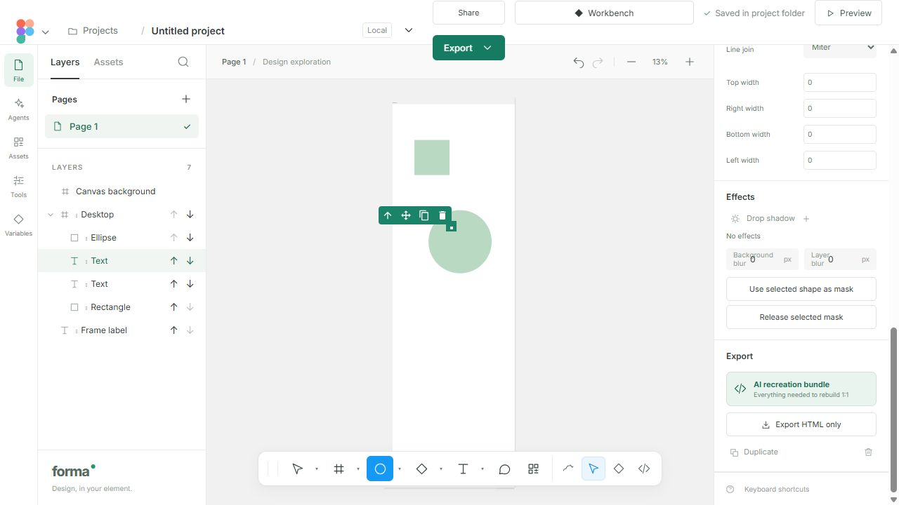

# Forma tutorial feasibility reassessment — 2026-11-10

## Verdict

**A comparable static landing-page design can be made in Forma. Completing the tutorial fully with the same Figma tools, workflow, and fidelity is not currently established and cannot be claimed as 1:1.** The live checks below validate several core steps, while important tutorial workflows remain unsupported, approximate, or unverified.

The reference is Flux Academy’s [Figma tutorial](https://www.youtube.com/watch?v=HZuk6Wkx_Eg). It teaches construction of a static page design. The later Webflow implementation is a separate lesson; a live newsletter backend is not needed to reproduce the design tutorial.

## Isolated live checks

These checks used a temporary, clean Forma project. The existing user projects were not edited, and the temporary test data was removed afterward.

| Action | Observed result | Assessment |
|---|---|---|
| Create a Desktop frame, 1440 × 4000, and configure a centered 12-column grid (15 px gutter, 1065 px max width) | The grid applied and the frame remained editable. | Passed for this basic setup. |
| Draw a rectangle at 13% zoom by dragging on the canvas | Its inspector coordinates and dimensions reflected the pointer location and zoom conversion. | Passed for this sample; other zoom levels and reverse drags were not tested in this pass. |
| Create and edit a text layer | Text could be entered directly on the canvas. | Passed for basic text entry. |
| Save a named text style, apply it to another text layer, then reload | The style applied (including its 28 px size) and remained available after reload; the project’s six layers remained present. | Passed for this basic save/apply/reload path. Undo/redo was not checked. |
| Apply and release an ellipse mask | Forma showed success messages for both actions. | Command path passed; independent movement, resize behavior, and rendered/exported mask fidelity remain unverified. |
| Open Preview | The preview contained the Desktop frame and entered heading. | Preview opened and included expected text; the complete tutorial page was not built or visually validated. |
| Search available actions for “group” | No matching action appeared. | Grouping is not available through that action search; direct UI parity is missing. |

Screenshot of the isolated editor check:

## Gaps that prevent a full 1:1 tutorial run

1. **Starter-file intake:** Forma’s project import is its own format; a Figma `.fig` starter file cannot be opened directly. Any tutorial assets must be obtained separately and brought in one by one.
2. **Typography controls and fonts:** The visible font choices are limited to Inter, Arial, Georgia, and Courier New. The tutorial’s exact typefaces (including Outfit/Roboto where used) are not both available in the picker, and the text inspector has no line-height control. Matching typography precisely is therefore blocked unless those fonts and controls are added.
3. **Layer organization and alignment:** Grouping and Figma-style tidy-up/smart alignment are missing from the current action search. Repeated cards and aligned sections can be positioned manually, but that is a different and more error-prone workflow.
4. **Image workflow:** Image fit/crop logic exists in the app, but image import, focal-position controls, replacement, and save/reopen behavior were not exercised in this reassessment. The tutorial’s image-heavy composition is not fully verified.
5. **Mask semantics:** Current masks are CSS clipping approximations, not proven equivalent to Figma vector masks. Moving/resizing content independently inside a mask and preserving the result in preview/export were not verified.
6. **End-to-end fidelity:** This pass did not build the full page, compare it visually against the video, or complete a full save → close → reopen → preview → export cycle. It cannot establish a finished tutorial result or pixel parity.

## What is already feasible

- Build a long desktop frame and a centered column grid.
- Draw basic shapes with pointer-based placement.
- Create and edit basic text.
- Save and apply a project-level text style through reload.
- Invoke basic mask apply/release commands.
- Open a preview containing the frame and text.

These are useful building blocks, but they do not close the gaps above. The right conclusion is **“partially feasible with manual workarounds,” not “tutorial completed” and not “Figma-equivalent.”**

## Work needed to make a credible complete attempt

- Add the tutorial’s exact fonts or allow local font selection, and expose line height in the text inspector.
- Add reliable group/ungroup, smart guides, tidy-up, and multi-selection alignment/distribution.
- Complete and exercise image import, crop/focal controls, replacement, and persistence.
- Validate mask content movement/resize and rendering in both Preview and export; improve the model if clipping alone is insufficient.
- Run the entire tutorial on a clean project and retain step-by-step screenshots plus the saved project and final export. Compare the page’s dimensions, typography, spacing, image treatment, gradients, and masks against the reference.

Until those checks pass, Forma can produce a similar composition, but cannot be represented as capable of completing the tutorial fully in the same way as Figma.

## Implementation follow-up — 2026-11-11

The source and packaged app now include Outfit/Roboto choices and line-height control; project-backed image import and fit/crop controls; and multi-layer group/ungroup, align, and distribute commands. The initial findings above are the state observed on 2026-11-10; consult the implementation follow-up in [the readiness plan](tutorial-readiness-plan.md) for changes made the next day. Native `.fig` import, exact Figma mask semantics, and full tutorial replay with visual comparison remain unresolved.
